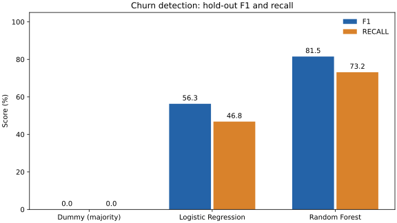
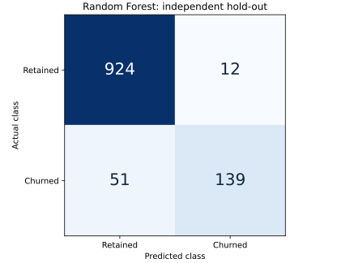

# E-commerce Customer Churn Prediction

[](https://github.com/salihozansabaz-pixel/musteri-kaybi-tahmini/actions/workflows/tests.yml)

[English](README.md) · [Türkçe](README.tr.md)

An educational machine-learning project comparing **Logistic Regression** and
**Random Forest** with a majority-class baseline on 5,630 e-commerce customer
records. The emphasis is reproducible evaluation: identical profiles stay in
the same partition, and preprocessing learns only from training data.

**Random Forest hold-out results: 94.40% accuracy, 81.52% F1, 73.16% recall.**
These describe this dataset and split, not verified production performance.



## Results

Reproduced on **3 November 2026** with Python 3.12 and the versions in
[`requirements-lock.txt`](requirements-lock.txt). Positive class: `Churn=1`.
No hyperparameter search or threshold tuning is performed.

| Model | Accuracy | Precision | Recall | F1 | Training CV F1, mean ± SD |
| --- | ---: | ---: | ---: | ---: | ---: |
| Majority baseline | 83.13% | 0.00% | 0.00% | 0.00% | 0.00% ± 0.00 pp |
| Logistic Regression | 87.74% | 70.63% | 46.84% | 56.33% | 63.60% ± 5.33 pp |
| Random Forest | 94.40% | 92.05% | 73.16% | 81.52% | 79.58% ± 3.34 pp |

The hold-out contains **1,126 records**, including **190 churned customers**.
Random Forest identifies 139 of those customers, misses 51, and flags 12
retained customers incorrectly. A model that predicts "retained" for everyone
already reaches 83.13% accuracy; F1 and recall reveal the difference.



Full metrics and confusion matrices: [evaluation_results.json](evaluation_results.json).
CV standard deviations are not confidence intervals.

## Quick start

Use **Python 3.12**. Create a virtual environment from the repository directory.

Windows PowerShell:

```powershell
python -m venv .venv
.\.venv\Scripts\python.exe -m pip install -r requirements-lock.txt
.\.venv\Scripts\python.exe train.py --no-plots --figure-dir docs/figures
.\.venv\Scripts\python.exe predict.py --input examples/customers.csv
.\.venv\Scripts\python.exe -W error -m unittest -v test_churn.py
```

macOS / Linux:

```bash
python3 -m venv .venv
.venv/bin/python -m pip install -r requirements-lock.txt
.venv/bin/python train.py --no-plots --figure-dir docs/figures
.venv/bin/python predict.py --input examples/customers.csv
.venv/bin/python -W error -m unittest -v test_churn.py
```

Training saves:
- `evaluation_results.json`: metrics (overwrites the existing report);
- `artifacts/churn_model.joblib`: fitted Random Forest and preprocessing;
- `docs/figures/`: figures when `--figure-dir` is supplied.

To preserve the checked-in report, pass `--output artifacts/my_results.json`.
Use `--data PATH` for another CSV with the same schema, and `--model-output PATH`
to change the saved model location. Paths supplied on the command line are
relative to your current directory. Default paths are relative to the project.
Without `--no-plots`, training opens interactive confusion-matrix windows.

## Predict new customers

`examples/customers.csv` contains **two invented demonstration records**.
Use all 18 feature columns in that file; `CustomerID` is optional, and `Churn`
must be absent. The spelling `PreferedOrderCat` matches the existing dataset.

```bash
python predict.py --model artifacts/churn_model.joblib --input examples/customers.csv --output artifacts/predictions.csv
```

Output contains the optional ID, `churn_probability`, and `churn_prediction`.
The prediction is the saved estimator's default binary decision. The
probability is an uncalibrated model output, not a verified personal risk.
Fixed category aliases, missing-value imputation, scaling, and encoding are
applied consistently. Prediction never fits a transformer or estimator.
Unknown categories are supported; missing columns and infinite numeric values
are rejected. Load only joblib files you created or trust; loading can execute
code. Keep training and inference dependency versions consistent.

## Evaluation design

1. Exclude `CustomerID` and `Churn`; retain 18 predictors.
2. Apply fixed category aliases and group identical feature profiles, including
   missingness, without consulting their target labels.
3. Reserve the first outer `StratifiedGroupKFold` split for the hold-out:
   4,504 training and 1,126 test records.
4. Perform five-fold group-aware CV on training records only.
5. Fit median/mode imputation, numeric scaling, and one-hot encoding inside
   each training fold using scikit-learn pipelines.
6. Evaluate all three models. Save the Random Forest fitted on the outer
   training partition only; the saved model has not seen the hold-out.

Random Forest uses 100 trees; Logistic Regression uses `max_iter=2000`.
Randomized components use `random_state=42`. Similar but non-identical profiles
may still be related; grouping only controls exact duplicates.

## Repository guide

| File | Purpose |
| --- | --- |
| `churn.py` | Shared preparation, splits, evaluation, persistence, and chart generation |
| `train.py` | Training command |
| `predict.py` | Saved-model batch prediction |
| `test_churn.py` | Nine regression and inference tests |
| `examples/customers.csv` | Synthetic inference examples |
| `requirements.txt` | Direct dependencies |
| `requirements-lock.txt` | Exact validated dependency versions |
| `.github/workflows/tests.yml` | Automated tests and full training/prediction smoke test |
| `docs/DATA_SOURCE.md` | Candidate attribution and unresolved redistribution questions |
| `docs/VALIDATION.md` | Local verification record |

The original Turkish-named Python entry point remains compatible.

## Data and limitations

The dataset's **candidate** upstream source is Ankit Verma's
[Ecommerce Customer Churn Analysis and Prediction on Kaggle](https://www.kaggle.com/datasets/ankitverma2010/ecommerce-customer-churn-analysis-and-prediction).
Its original download and the bundled CSV's transformation history were not
available, so provenance and redistribution permission remain unverified.
See [the data note](docs/DATA_SOURCE.md) before changing repository visibility.

The table contains 948 positives, 1,856 missing feature cells, and 557 repeated
profiles after category normalization. Measurement times, the operational churn
definition, and future-customer performance have not been verified. No external
or chronological validation, probability calibration, deployment monitoring,
or business-cost optimization is included.

The repository remains private pending provenance review. No open-source
license is assigned by this update.
