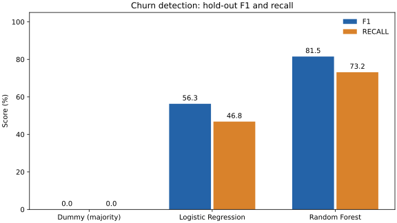

# E-Ticarette Müşteri Kaybı Tahmini

[English](README.md) · [Türkçe](README.tr.md)



3 Kasım 2026 güncellemesi: dokuz test, model kaydetme/yükleme, sentetik müşteri örnekleriyle tahmin ve otomatik test akışı eklendi. Güncel komutlar ve dosyalar için İngilizce ana README’ye bakın. Doğrulanmış bağımlılıkların tamamı `requirements-lock.txt` içindedir.

E-ticaret müşterilerinin müşteri kaybı (`Churn`) durumunu tahmin etmek için **Logistic Regression** ve **Random Forest** modellerini karşılaştıran Python projesi. Veri hazırlama, grup bazlı veri bölme, çapraz doğrulama ve bağımsız hold-out değerlendirmesi içerir. Çoğunluk sınıfını tahmin eden `DummyClassifier`, referans modeldir.

## Doğrulanmış sonuçlar

Sonuçlar 3 Kasım 2026 tarihinde Python 3.12 ve `requirements-lock.txt` içindeki sürümlerle yeniden üretilmiştir. Pozitif sınıf `Churn=1`'dir. Modeller varsayılan sınıflandırma eşikleriyle değerlendirilmiştir; hiperparametre veya eşik optimizasyonu yapılmamıştır.

| Model | Test accuracy | Test precision | Test recall | Test F1 | Eğitim CV F1 (ortalama ± std) |
| --- | ---: | ---: | ---: | ---: | ---: |
| Dummy (çoğunluk) | %83,13 | %0,00 | %0,00 | %0,00 | %0,00 ± 0,00 |
| Logistic Regression | %87,74 | %70,63 | %46,84 | %56,33 | %63,60 ± 5,33 |
| Random Forest | %94,40 | %92,05 | %73,16 | %81,52 | %79,58 ± 3,34 |

CV standart sapmaları yüzde puanı cinsindendir; güven aralığı değildir. Test kümesinde 1.126 kayıt ve 190 pozitif örnek vardır. Random Forest 139 pozitif örneği yakalar, 51'ini kaçırır; 12 yanlış pozitif tahmin yapar. Bu sonuç, yalnızca accuracy değerinin yeterli olmadığını gösterir: sürekli `0` tahmin eden referans model bile %83,13 doğruluk elde eder.

Tam metrikler, karmaşıklık matrisleri ve veri bölme özeti [`evaluation_results.json`](evaluation_results.json) dosyasındadır. Matrislerde satırlar gerçek, sütunlar tahmin edilen sınıflardır; sıra `[0, 1]`'dir.

## Veri ve doğrulama yöntemi

- Veri dosyası 5.630 satır, hedef ve kimlik dahil 20 sütun içerir; 948 satırda `Churn=1`'dir.
- `CustomerID` ve `Churn` çıkarıldıktan sonra 18 özellik kalır. Özelliklerde toplam 1.856 eksik hücre bulunur. Dosya adında “temizlenmiş” yazması eksik değer bulunmadığı anlamına gelmez.
- Giriş cihazı, ödeme yöntemi ve ürün kategorisindeki eş anlamlı etiketler sabit kurallarla birleştirilir. Bu işlem veriden istatistik öğrenmez.
- Kimlik hariç ham veride 556 tekrar kayıt vardır. Kategori adları birleştirildikten sonra hedef ve kimlik hariç 557 tekrar profil bulunur. Bunların gerçek hayatta aynı müşteri olduğu varsayılmaz; kayıtlar silinmez.
- Aynı özelliklere ve eksik değer desenine sahip profiller, hedef etiket kullanılmadan gruplanır. Bir profilin eğitim ve değerlendirme bölümlerine dağılması engellenir.
- `StratifiedGroupKFold(n_splits=5, shuffle=True, random_state=42)` ilk dış katı hold-out olarak ayırır. Bu veride 4.504 eğitim, 1.126 test kaydı oluşur. Grup kısıtı nedeniyle oranlar her veri setinde tam %80/%20 olmak zorunda değildir.
- Beş katlı iç çapraz doğrulama yalnızca eğitim bölümünde çalışır ve profil gruplarını korur. Hold-out verisi ön işleme öğreniminde ve çapraz doğrulamada kullanılmaz.
- Her modelin `Pipeline` yapısında sayısal eksikler eğitim medyanıyla, kategorik eksikler eğitim moduyla doldurulur. Sayısal özellikler `StandardScaler`, kategorik özellikler `OneHotEncoder(handle_unknown='ignore')` ile dönüştürülür.
- Eğitim/test ve iç CV bölümleri arasında ortak profil olmadığı, her bölümde iki sınıfın da bulunduğu kod içinde kontrol edilir. Eksik hedef veya tekrar eden müşteri kimliği sessizce düzeltilmek yerine hata üretir.

Logistic Regression `max_iter=2000`, Random Forest `n_estimators=100` kullanır. Rastgelelik içeren model ve bölmelerde `random_state=42` sabittir.

## Kurulum ve çalıştırma

Python 3.11 veya üstünü kullanın; doğrulama Python 3.13.14 ile yapılmıştır. Terminali proje klasöründe açın.

Windows PowerShell:

```powershell
python -m venv .venv
.\.venv\Scripts\python.exe -m pip install -r requirements-lock.txt
.\.venv\Scripts\python.exe "veri_dersi_müşteri_kaybı.py" --no-plots
.\.venv\Scripts\python.exe -W error -m unittest -v test_churn.py
```

macOS / Linux:

```bash
python3 -m venv .venv
.venv/bin/python -m pip install -r requirements-lock.txt
.venv/bin/python "veri_dersi_müşteri_kaybı.py" --no-plots
.venv/bin/python -W error -m unittest -v test_churn.py
```

Grafik pencerelerini görmek için `--no-plots` seçeneğini kaldırın. Program grafik penceresinde beklerse devam etmek için pencereyi kapatın. Grafik modu masaüstü grafik desteği gerektirir; otomatik doğrulama grafik açmadan yapılmıştır.

CSV, Python dosyasının yanından okunur; programı farklı bir çalışma klasöründen de çağırabilirsiniz. Sonuçlar varsayılan olarak proje içindeki `evaluation_results.json` dosyasına yazılır ve önceki sonuçların üzerine yazılır. Başka bir konum için `--output sonuc.json` kullanın. Eğitilmiş Random Forest ve ön işleme adımları artık `artifacts/churn_model.joblib` dosyasına kaydedilir. Bu model yalnızca eğitim bölümünde öğrenir; hold-out ile yeniden eğitilmez. `predict.py --input examples/customers.csv` komutu kayıtlı modelle tahmin üretir. Örnek müşteriler elle üretilmiş sentetik kayıtlardır.

## Dosyalar

| Dosya | Açıklama |
| --- | --- |
| `veri_dersi_müşteri_kaybı.py` | Ön işleme, grup bazlı bölme, model eğitimi ve değerlendirme |
| `e_commerce_dataset_temizlenmis.csv` | Girdi verisi |
| `evaluation_results.json` | Doğrulanmış çalıştırmanın metrikleri |
| `test_churn.py` | Bölmelerin ayrılığı, eğitimle sınırlı ön işleme ve geçersiz veri testleri |
| `requirements.txt` | Doğrulamada kullanılan sabit bağımlılık sürümleri |
| `.gitignore` | Yerel ortam ve geçici dosyalar için hariç tutma kuralları |

## Yapılan doğrulama ve düzeltmeler

Önceki sürüm çalıştırıldığında Random Forest yaklaşık %98 test doğruluğu veriyordu. Ancak eski rastgele test bölmesindeki 189 kaydın eğitim verisinde aynı özelliklere sahip karşılığı vardı; medyan doldurma da veri bölünmeden önce uygulanıyordu. Bunlar değerlendirmeyi iyimser yapabilir. Ön işleme eğitim katlarına taşındı, tekrar profiller aynı bölmede tutuldu, kategorik kodlama ve ölçekleme düzeltildi, referans model eklendi.

Yeni sürüm `python -W error veri_dersi_müşteri_kaybı.py --no-plots` ile uyarılar hata sayılarak başarıyla çalıştırıldı. Dokuz regresyon ve tahmin testi geçti. Eski ve yeni sonuçlarda veri bölmesi ve ön işleme birlikte değiştiği için farkın tamamı tek bir düzeltmeye atfedilemez.

## Sınırlamalar

Bu veri üzerinde Random Forest, referans ve Logistic Regression modellerinden daha iyi sonuç vermektedir. Bu, başka müşterilerde veya gelecekte aynı başarıyı garanti etmez. Olası kaynak ve henüz doğrulanamayan lisans bilgisi `docs/DATA_SOURCE.md` içinde açıklanmıştır; özelliklerin müşteri kaybından önce ölçüldüğü de doğrulanmamıştır. Zamana dayalı veya dış veriyle doğrulama yapılmamıştır. Profil gruplama tam eşleşmeleri kontrol eder; benzer fakat eşit olmayan kayıtların bağımsızlığını kanıtlamaz.

Proje eğitim ve model karşılaştırması için uygundur. Gerçek kullanım öncesinde veri kaynağı, zaman ilişkisi, hata maliyetleri ve dış veri başarısı ayrıca değerlendirilmelidir.
